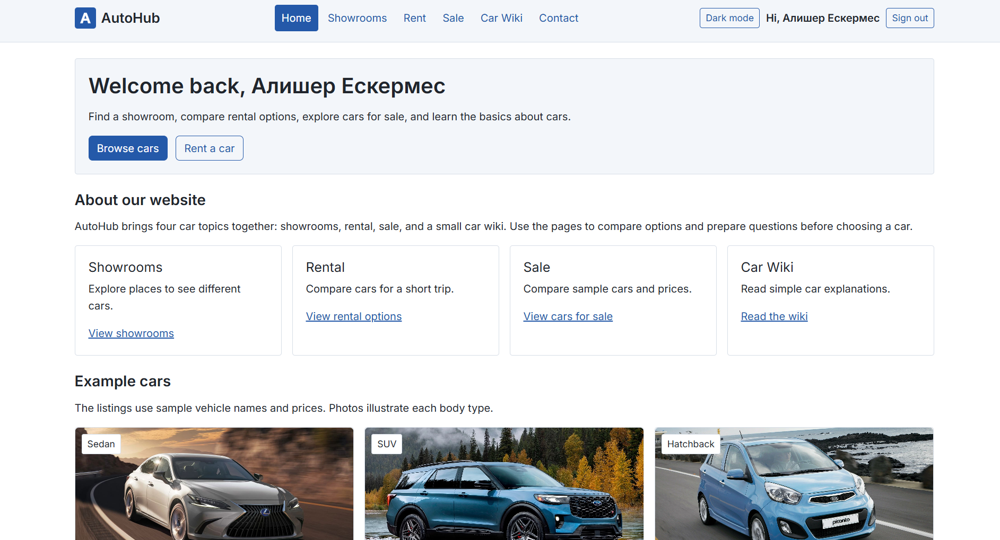
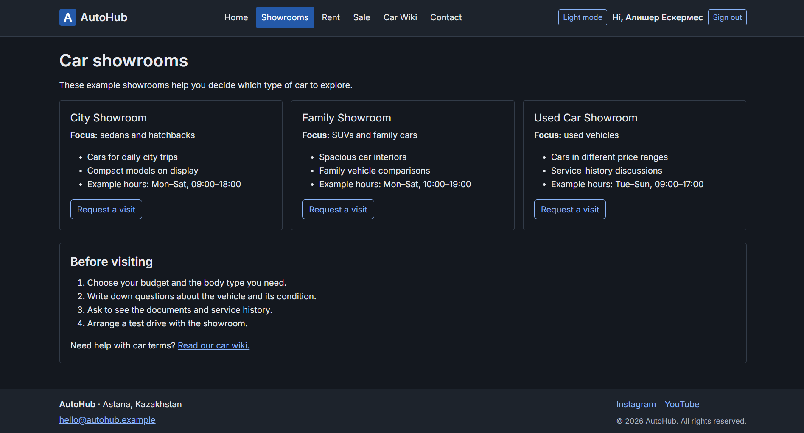
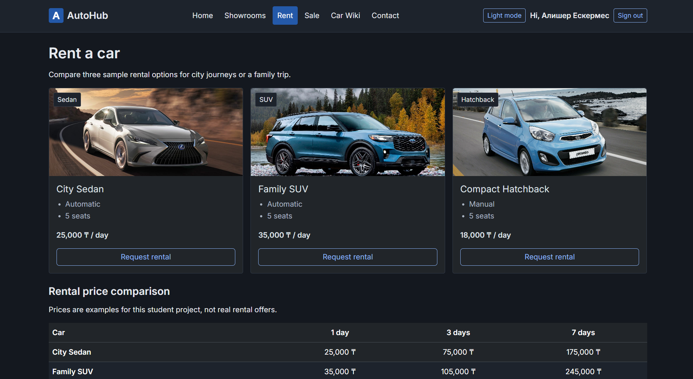
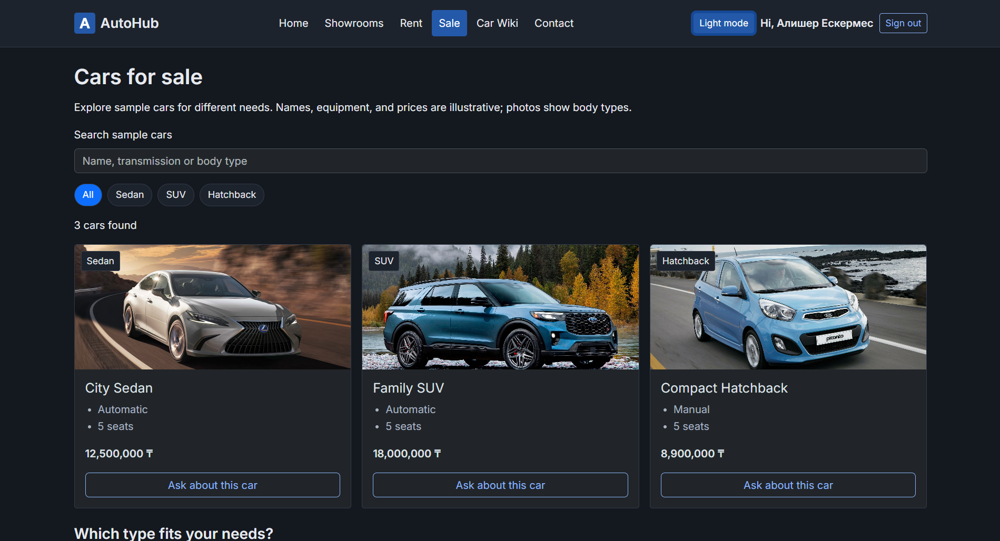
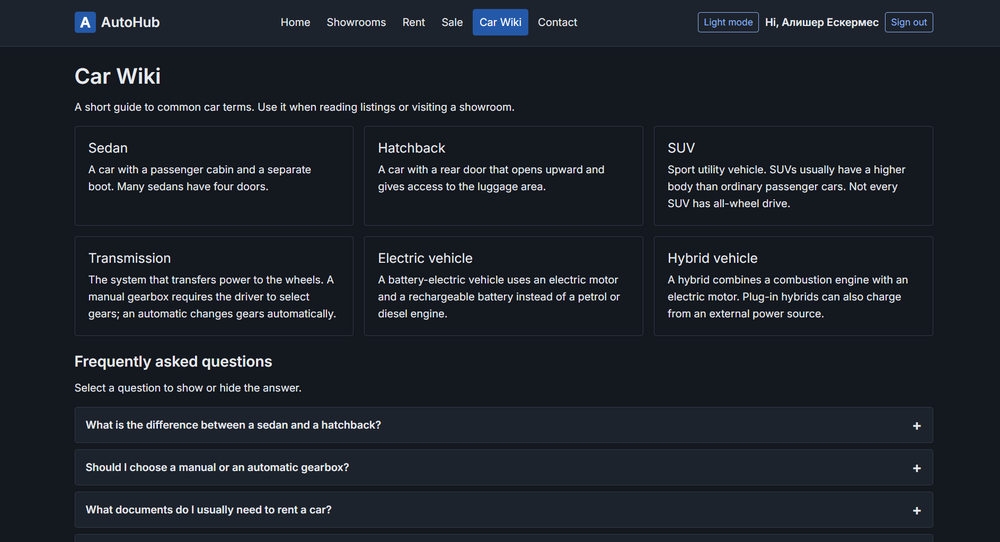
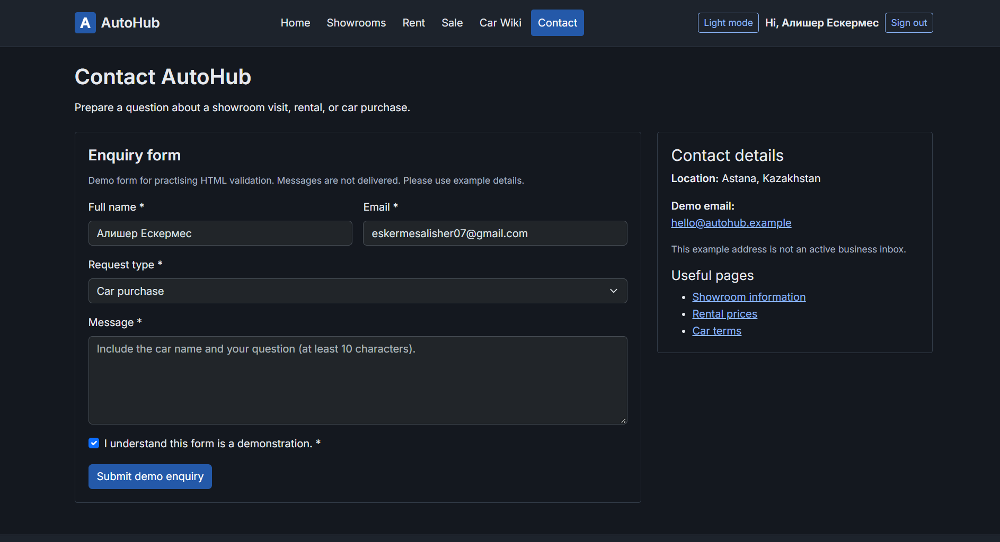

# AutoHub

## Group members

- Askar kairatbek
- Tolbasy Aliakbar
- Yeskermes Alisher

## Project description

AutoHub is a responsive multi-page website about cars.
It includes Home, Showrooms, Rent, Sale, Car Wiki, and Contact pages.
Users can browse example cars, compare rental prices, and read
basic information about cars.

## Features implemented

- Navigation menu, logo, header, main content, and footer on every page.
- Car cards, images, lists, rental pricing table, and contact form.
- External CSS with variables, hover and focus states, and nth-child.
- Flexbox, CSS Grid, and relative/absolute positioning.
- Responsive layouts using media queries and Bootstrap grid.
- Bootstrap spacing, text alignment, buttons, and containers.
- Custom font and lazy-loaded car images.

## Technologies used

- HTML5
- CSS3
- Bootstrap 5.3.3
- JavaScript (DOM, events, fetch, localStorage)
- jQuery 3.7.1 (bundled locally)

## Individual contribution

### Askar Kairatbek

Worked on the Home and Showrooms pages.
Implemented the header, logo, navigation menu, and Flexbox layout.

**Home page:**

**Showrooms page:**

### Tolbasy Aliakbar

Worked on the Rent and Sale pages.
Implemented car cards, the rental pricing table, Bootstrap grid,
and relative/absolute positioning for car labels.

**Rent page:**

**Sale page:**

### Yeskermes Alisher

Worked on the Car Wiki and Contact pages.
Implemented CSS Grid, the HTML contact form,
responsive media queries, and README documentation.

**Car Wiki page:**

**Contact page:**

## How to use the interactive features

- On the Sale page, search for cars or filter them by body type.
- In Manage Sample Inventory, add, edit, or delete car records.
- Inventory changes are saved in the current browser only.
- On the Home page, select a photo to open the gallery. Use the arrows or keyboard arrow keys to browse.
- On the Contact page, complete the form to see the validation feedback. This demo does not send messages.
- 
# Final project part

## New features

- **Light/Dark theme:** the button in the header switches themes on every page. The choice is saved in `localStorage` and stays after refresh.
- **Registration / demo sign-in:** `signin.html` validates name, email, password strength and matching confirmation. Passwords are never saved or sent. This is a browser-only demo, not secure account authentication. The user is stored in `localStorage`, stays signed in after refresh, sees "Hi, name" and a Sign out button in the header, a personal greeting on the Home page, and a pre-filled Contact form. Sign out clears the saved state.
- **FAQ (jQuery):** six car questions on the Car Wiki page. `.slideToggle()` opens and closes answers, and a + / − indicator shows the state.
- **API (fetch):** the Sale page loads real car brands and models from the free [NHTSA vPIC API](https://vpic.nhtsa.dot.gov/api/). Users search brands, select one, filter models by year, and refresh the data. Errors and empty results show clear messages.

## Project structure

- `index.html`, `showrooms.html`, `rent.html`, `sale.html`, `wiki.html`, `contact.html`, `signin.html`
- `css/style.css` — styles, including the dark theme
- `js/script.js` — theme, sign-in, FAQ (jQuery), and API code

## Links

- Website: https://achaka119.github.io/Auto-Hub/
- Repository: https://github.com/achaka119/Auto-Hub

## Run and publish

Run `python3 -m http.server 8000` in this folder and open http://localhost:8000.

