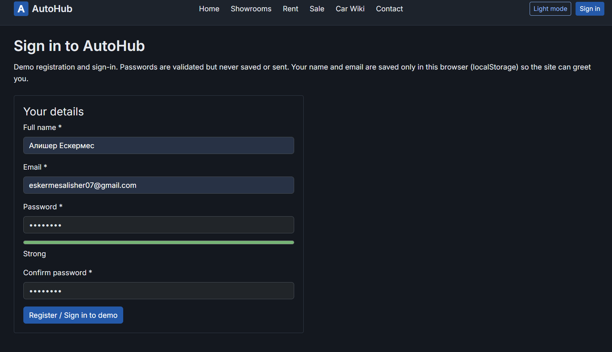
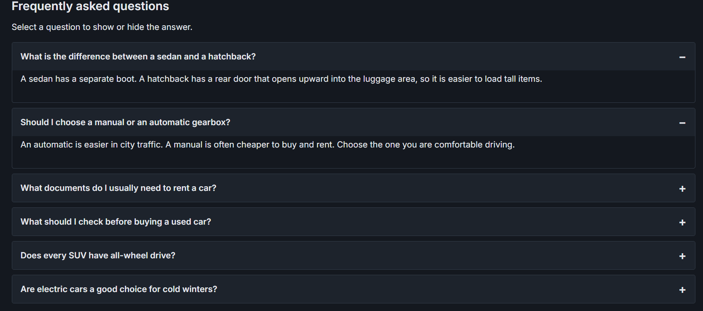
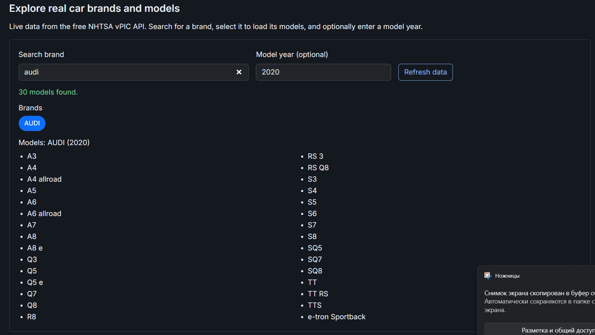
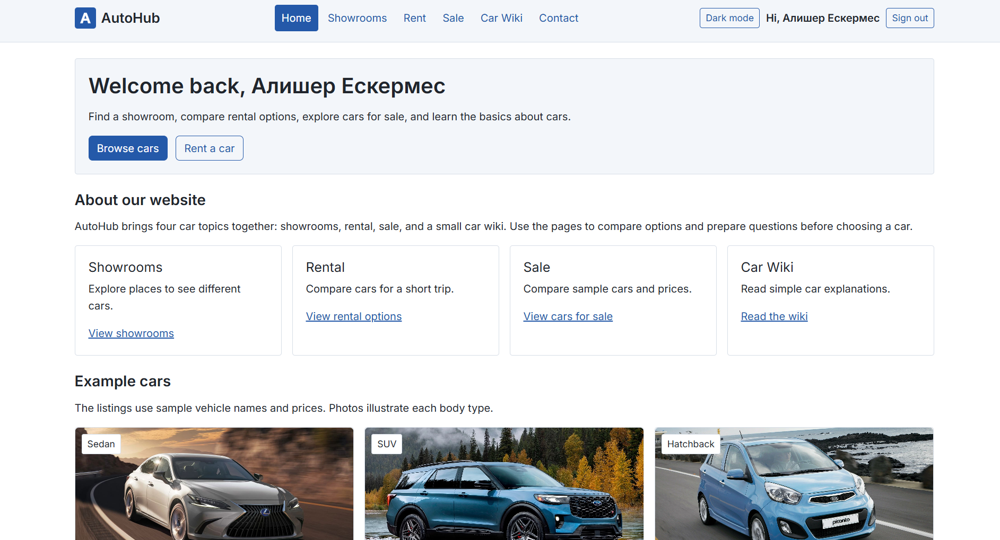
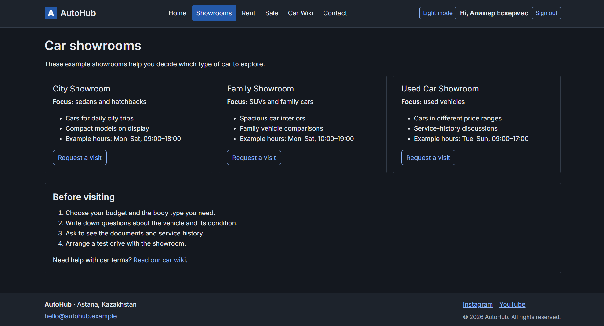
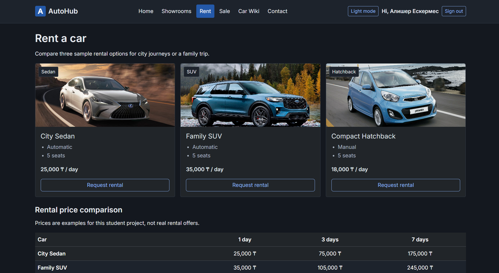
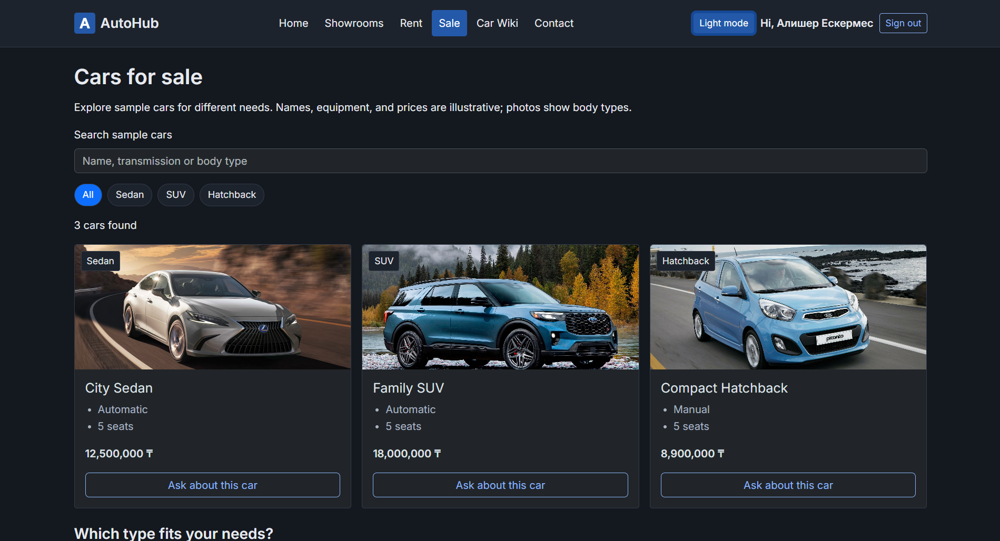
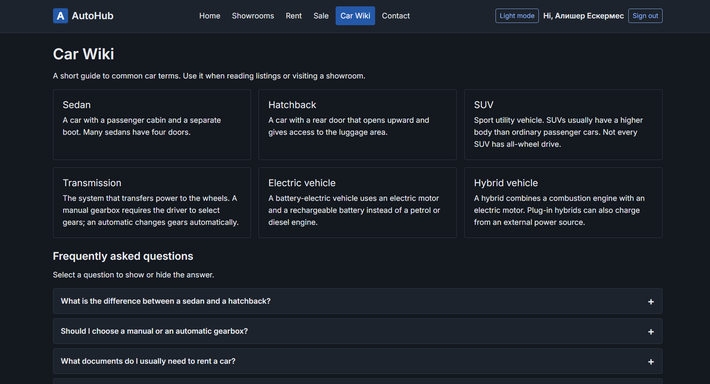
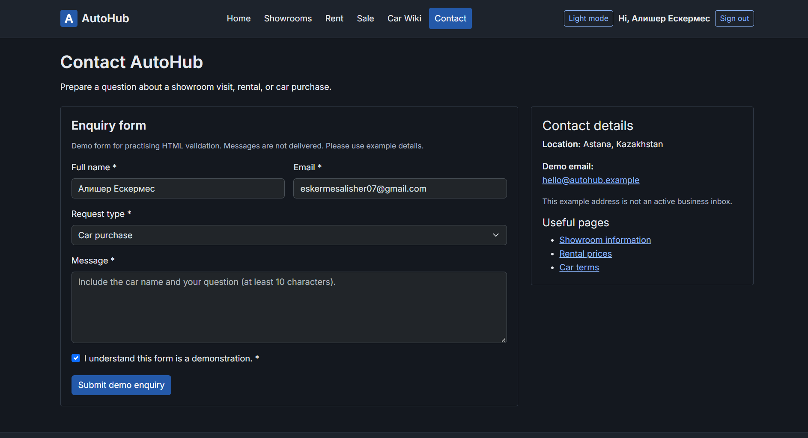

# AutoHub: Final Project Report
 
**Group:** IT-2501 
**Members:** Askar Kairatbek, Tolbasy Aliakbar, Yeskermes Alisher

## 1. Project Overview

AutoHub is a responsive car website where users can explore sale and rental offers, showrooms, and car information. The project applies HTML, CSS, Bootstrap, JavaScript, jQuery, and a public API.

## 2. Website Structure

The website has seven pages: Home, Showrooms, Rent, Sale, Car Wiki, Contact, and Sign In. All pages share navigation and a consistent design.

## 3. Main Features

The website includes responsive layouts, light and dark themes saved in `localStorage`, demo sign-in, car search and filters, inventory management, a gallery, and a validated contact form.

The Car Wiki page has a six-question FAQ using jQuery `slideToggle()`. The Sale page uses `fetch()` to display vehicle data from the NHTSA vPIC API and shows messages if data cannot be loaded.

## How to use the interactive features

- On the Sale page, search for cars or filter them by body type.
- In Manage Sample Inventory, add, edit, or delete car records.
- Inventory changes are saved in the current browser only.
- On the Home page, select a photo to open the gallery. Use the arrows or keyboard arrow keys to browse.
- On the Contact page, complete the form to see the validation feedback. This demo does not send messages.

## New features

- **Light/Dark theme:** the button in the header switches themes on every page. The choice is saved in `localStorage` and stays after refresh.
- **Registration / demo sign-in:** `signin.html` validates name, email, password strength and matching confirmation. Passwords are never saved or sent. This is a browser-only demo, not secure account authentication. The user is stored in `localStorage`, stays signed in after refresh, sees "Hi, name" and a Sign out button in the header, a personal greeting on the Home page, and a pre-filled Contact form. Sign out clears the saved state.
**Sign in page:**

- **FAQ (jQuery):** six car questions on the Car Wiki page. `.slideToggle()` opens and closes answers, and a + / − indicator shows the state.

**Faq:**

- **API (fetch):** the Sale page loads real car brands and models from the free [NHTSA vPIC API](https://vpic.nhtsa.dot.gov/api/). Users search brands, select one, filter models by year, and refresh the data. Errors and empty results show clear messages.

**API:**

## 4. Development 

The group developed the website in three stages: page layout, interactive features, and final-project features including the theme, FAQ, and API.

## 5. Individual contribution

### Askar Kairatbek

Worked on the Home and Showrooms pages.
Implemented the header, logo, navigation menu, and Flexbox layout.

**Home page:**

**Showrooms page:**

### Tolbasy Aliakbar

Worked on the Rent and Sale pages.
Implemented car cards, the rental pricing table, Bootstrap grid,
and relative/absolute positioning for car labels.

**Rent page:**

**Sale page:**

### Yeskermes Alisher

Worked on the Car Wiki and Contact pages.
Implemented CSS Grid, the HTML contact form,
responsive media queries, and README documentation.

**Car Wiki page:**

**Contact page:**

## 6. AI Acknowledgement

AI tools supported our development by helping us identify code issues and improve the organization of our files. We used them according to the course guidelines.

## 7. Links

- **Repository:** https://github.com/achaka119/Auto-Hub
- **Website:** https://achaka119.github.io/Auto-Hub/

## 8. Conclusion

This project helped us practise building a responsive website and adding interactive features with JavaScript, jQuery, and an API. [Add one improvement you would make in the future.]
